<div align="center">

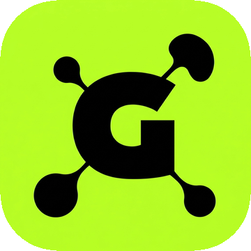

# GraphRecall

An active knowledge graph of everything you learn.<br>
Put anything in. It comes back to you as a feed you actually open,<br>
an assistant that knows what you know, and context for every AI agent you use.

### See it in action at **[graphrecall.online](https://graphrecall.online)**

<a href="https://graphrecall.online"></a>

[](ios/)
[](backend/)
[](backend/graphs/)
[](https://github.com/pgvector/pgvector)
[](https://neo4j.com)
[](https://ai.google.dev)
[](backend/agent_bridge/)

### Watch the demo

<a href="https://graphrecall.online/#film">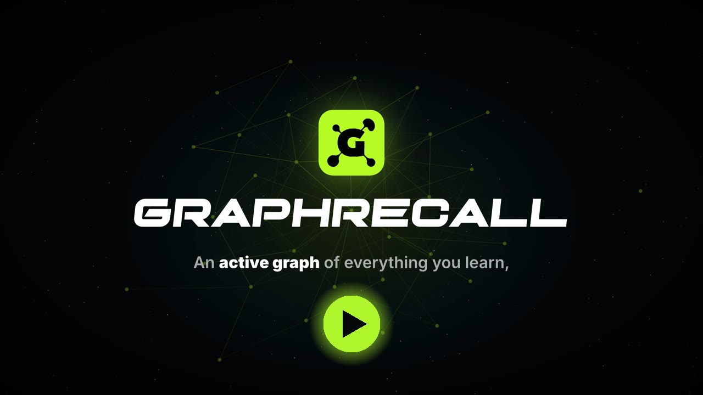</a>

</div>

---

## Contents

- [GraphRecall in one minute](#graphrecall-in-one-minute)
- [How it started](#how-it-started)
- [Architecture today](#architecture-today)
- [Ingestion: from anything to concepts](#ingestion-from-anything-to-concepts)
- [The assistant: hybrid GraphRAG](#the-assistant-hybrid-graphrag)
- [The learning loop](#the-learning-loop)
- [MCP: your knowledge as context for any agent](#mcp-your-knowledge-as-context-for-any-agent)
- [Keeping it cheap](#keeping-it-cheap)
- [Tests and evaluation](#tests-and-evaluation)
- [Repository layout](#repository-layout)
- [Running it locally](#running-it-locally)
- [What's next](#whats-next)

---

## GraphRecall in one minute

Knowledge graphs are everywhere, and most of them, like most piles of notes, are pictures that never get opened again. GraphRecall builds an **active** graph of every concept you've been exposed to, and keeps bringing it back to you.

### 1. Put anything in
<p align="center">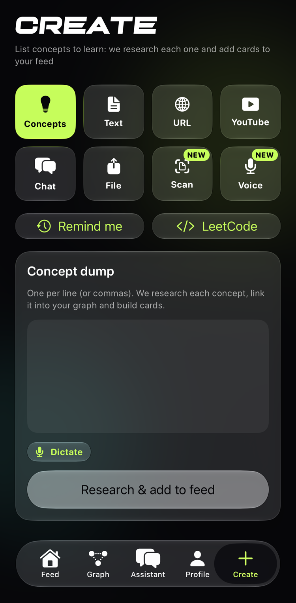</p>

Type concepts or text, paste a URL or a YouTube video, import a chat history, upload files and whole books, scan pages and photos, or just talk. Share to GraphRecall from any app. Log LeetCode problems by number: type 146 and the title, difficulty, topics and pattern fill in.

### 2. It becomes your graph
<p align="center">
  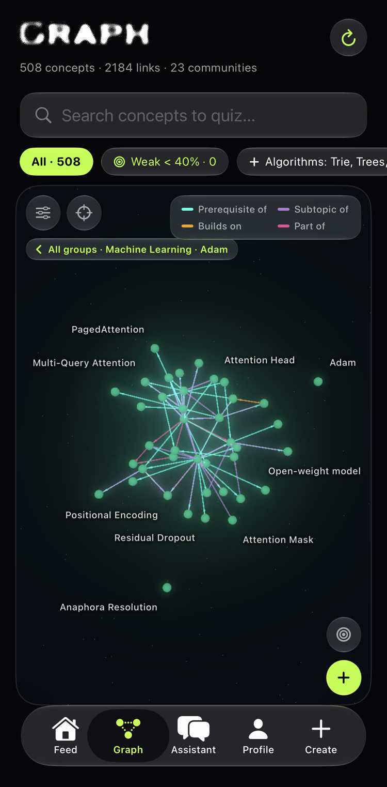
  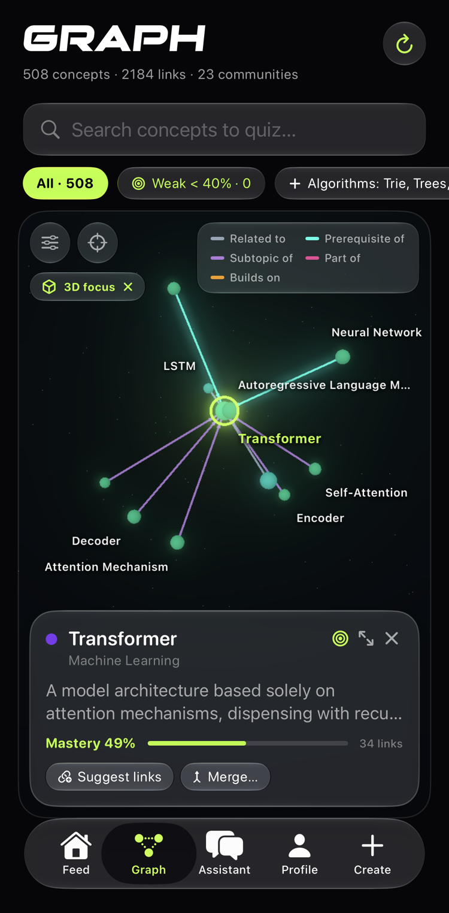
</p>

Each concept **merges into a node you already have or becomes a new one**, linked by typed, directed edges: *prerequisite of*, *subtopic of*, *builds on*. Communities are detected and named. Tap a community to go inside it; tap a concept to see only what it needs, what it's part of and what it unlocks.

### 3. It comes back as a feed you actually open
<p align="center">
  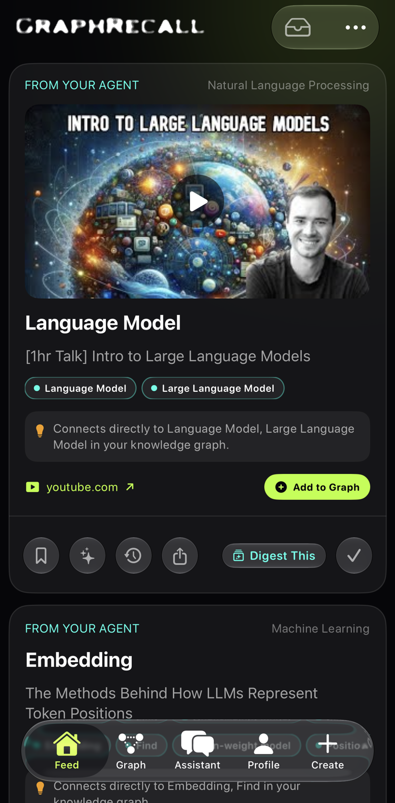
  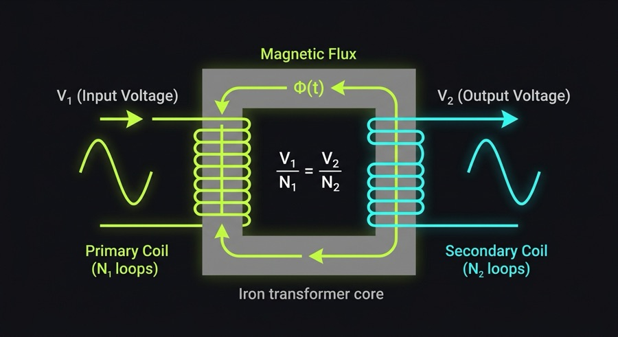
</p>

- **Everything that needs your attention today, in one feed:** spaced-repetition reviews, newsletters and important updates.
- **Hand-crafted cards for each kind of content:** concept cards with figures from your own papers, term cards, multiple-choice quizzes, "spot the bug", runnable code sandboxes, diagrams with hidden labels, and videos and articles from sources you follow, each matched to concepts in your graph.
- **Built for brains that wander:** it scrolls like social media, with no goal rings or streak guilt. You rate recall on Apple's native slider, and "Remind me" brings any card back later.
- **Pictures that teach:** where your sources have no figure, a Gemini image model (Nano Banana) redraws the real reference diagram in the app's style (right).

### 4. An assistant that knows what you know
<p align="center">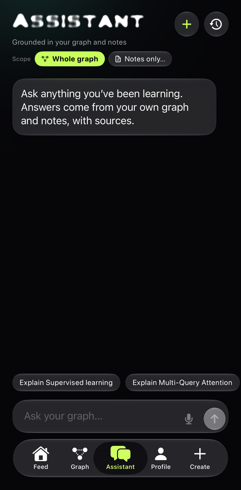</p>

Answers come from your own notes and books with numbered citations, readable math and code. The "Ask next" suggestions come from your graph: a prerequisite you're shaky on, a subtopic you haven't studied, what the concept unlocks.

### 5. Your profile, measured
<p align="center">
  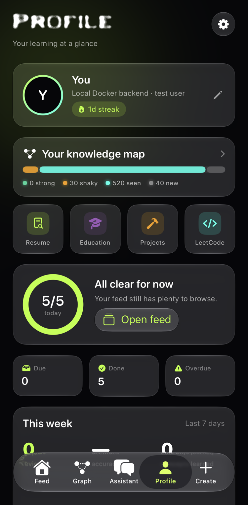
  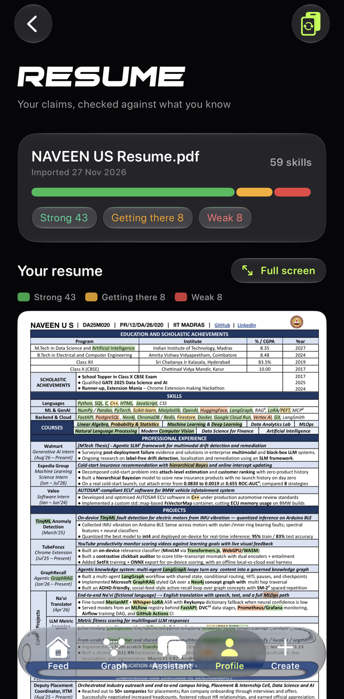
</p>

Every concept is strong, shaky, seen or new, based on evidence: reviews, quiz answers, code results and self-ratings. **Resume/JD check:** every skill on your resume is highlighted from red to green by what your graph says about you, for an at-a-glance picture of how ready you are.

### 6. Your knowledge as context for any AI agent
Paste a research paper into Claude and ask it to explain. Claude asks GraphRecall's MCP server what you know well, what you're shaky on and what you've never seen, refreshes the shaky parts and teaches the new ideas at your level. After the session it sends back every concept you discussed, plus a summary, so your graph grows from those conversations too.

---

## How it started

GraphRecall began in January 2026 as a **React web app on a LangGraph multi-agent setup**. A supervisor graph classified each request and routed it to a specialised sub-graph: ingestion, chat, research, Mermaid diagrams or content generation. Ingestion paused at a human-in-the-loop `interrupt()` so you could approve every extracted concept. A "scanner" agent marked quiz-worthy passages and generated questions just in time, and a Tavily-backed research agent filled gaps from the web. It ran on Render and Vercel.

That version proved the idea, but it called a model at almost every step. Since then the project has moved to:

- **a native iOS 26 app** as the main client;
- **one focused workflow per job** instead of a general supervisor;
- **no model calls where a model isn't needed:** a trained classifier for routing, graph-picked follow-ups and rule-based book chunking;
- **evidence-based mastery** that drives the feed, the resume check and the MCP server.

The old web client (`frontend/`) and the supervisor graph (`backend/graphs/supervisor_graph.py`) are still in the repo for reference.

---

## Architecture today

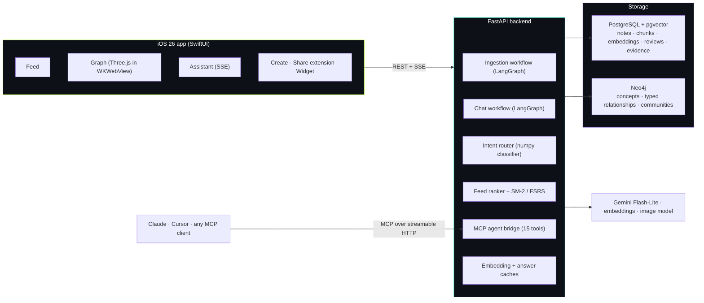

| Layer | Technology |
|---|---|
| iOS app | SwiftUI on iOS 26 (Liquid Glass), WKWebView + Three.js for the graph, PDFKit, on-device dictation and OCR, a share extension and a widget |
| API | FastAPI (Python 3.11+), LangGraph for the ingestion and chat workflows, Server-Sent Events for streaming |
| Storage | PostgreSQL with pgvector, Neo4j |
| Models | Gemini Flash-Lite for extraction, chat and cards; Gemini embeddings; a Gemini image model for illustrations; a locally trained classifier for intent routing |
| Agents | MCP over streamable HTTP, scoped API keys, OAuth 2.1 with PKCE |

---

## Ingestion: from anything to concepts

The ingestion workflow (`backend/graphs/ingestion_graph.py`):

```
parse → chunk → extract propositions → embed → save chunks → extract concepts
      → store note → find related concepts → synthesize → create / merge concepts
      → link → generate cards
```

- **Books** go through a rule-based, image-aware chunker (`backend/services/book_chunker.py`) with no model calls. It keeps headings as hierarchy hints, never separates a figure from its caption, and overlaps chunks by about 15%.
- **Parent and child chunks:** retrieval matches small child windows and answers with the surrounding parent section.
- **Merge or create:** each extracted concept is matched against your graph by normalised name and embedding similarity. It either merges into an existing node (adding evidence and links) or becomes a new one. A human-review step is still available but optional.
- **Communities and subjects:** Louvain community detection groups concepts, a model names each community, and a taxonomy rolls communities up into subjects (`backend/services/graph_hierarchy.py`).
- **Figures:** cropped from your PDFs and attached to a card only when the caption is genuinely about the concept (`backend/services/concept_figures.py`).
- **Other sources:** YouTube, articles, Substack and RSS feeds (`substack_sync.py`), forwarded newsletters (`email_ingest.py`), voice dictation streamed into the graph (`dictation_graph.py`) and LeetCode lookups by number (`leetcode.py`).

---

## The assistant: hybrid GraphRAG

The chat workflow (`backend/graphs/chat_graph.py`) is three nodes: `analyze_query → get_context → generate_response`.

1. **Intent routing without an LLM call.** Word and character TF-IDF features feed a logistic regression trained offline with scikit-learn and re-implemented in plain numpy. Parity with sklearn is asserted at training time. It routes alone when confident and asks a model only when unsure. Every decision is logged (`backend/services/intent_router/`).
2. **Query analysis.** Follow-ups are anchored to the previous turn's topic, and concept names from your graph become seeds.
3. **Graph context.** The seeds and vector-similar concepts pull in their Neo4j neighbourhood: definitions, typed relationships and your mastery.
4. **Hybrid retrieval.** pgvector similarity, PostgreSQL full-text search and a graph boost are fused with reciprocal rank fusion (k = 60). Results are deduplicated by parent chunk, reranked, diversified with MMR and ordered against "lost in the middle".
5. **Community map-reduce only when it helps.** "Summarise what I know about…" questions fan out over community summaries; other intents never do.
6. **Grounded or honest.** Answers cite numbered sources, and a grounding guard says so when your notes don't cover the question.
7. **Graph-picked follow-ups.** About 0.2 s and zero tokens (`backend/services/followups.py`); taps are logged per suggestion type.

---

## The learning loop

- **Scheduling:** SM-2 by default, with FSRS v4 selectable per user (`backend/services/spaced_repetition.py`).
- **Feed ranking:** the ranker (`backend/feed_ranker/`) scores urgency with FSRS-style retrievability and graph signals. After a lapse, it brings back the **weakest prerequisite** underneath before the harder concept.
- **Pacing:** a daily cap keeps the feed short, and the backlog never piles up into guilt (`feed_pacing.py`).
- **Evidence:** reviews, quiz answers, code results, self-ratings and notes set each concept's status, which drives the profile, the resume check and the MCP server (`knowledge_map.py`, `resume.py`).
- **Code cards** run offline in a locked-down WKWebView sandbox.

---

## MCP: your knowledge as context for any agent

GraphRecall runs an MCP server over streamable HTTP (`backend/agent_bridge/`, enabled with `AGENT_BRIDGE_ENABLED=1`). Clients connect with a scoped key (`read:knowledge`, optionally `write:feed`) or OAuth 2.1. Host and Origin checks, per-key rate limits and an audit log protect it, and keys are hashed at rest.

| Tool | What it does |
|---|---|
| `get_knowledge_frontier` | For a task: what you know well (to explain through), what's shaky (refresh in a line), what you've never seen (teach properly), misconceptions and where you learned each thing |
| `get_knowledge_profile`, `get_capability_blueprint` | Your knowledge by status and domain, education, courses with grades and projects. Returned with a stable hash an agent can cache as a prompt prefix |
| `search_concepts`, `get_concept_neighborhood`, `assess_concepts` | Look things up in your graph |
| `list_due_reviews`, `get_recent_activity` | What's due and what you've been doing |
| `record_exposure` | After a session, the agent records each concept you discussed |
| `propose_feed_items`, `suggest_for_later`, `schedule_daily_digest` | The agent can send a session summary, reading or exam prep to your feed, for you to approve |

---

## Keeping it cheap

- Small, fast models by default (Gemini Flash-Lite), set by `GEMINI_CHAT_MODEL` and `GEMINI_FAST_MODEL`.
- Routing by a local classifier and follow-ups from the graph: no model call for either.
- Books chunked by rules, not by a model.
- An embedding cache, and an answer cache partitioned by a version of your notes, so a deleted note is never served back (`rag_cache.py`).
- Community map-reduce runs only for summary questions.
- Per-day usage tracking (`quota.py`).

---

## Tests and evaluation

- **604 backend tests** (`pytest backend/tests`) covering chat, retrieval, follow-ups, the feed ranker, the MCP bridge, ingestion, LeetCode lookup, the graph hierarchy and more. iOS unit and UI tests are in `ios/GraphRecallTests` and `ios/GraphRecallUITests`.
- **Evaluation harnesses** in `eval/`: GraphRAG retrieval and answer quality (`graphrag/`), the intent router (`router/`), grounding (`grounding/`), the scheduler (`scheduler/`) and the feed algorithm (`feed_algo/`).

---

## Repository layout

```
backend/
  agent_bridge/     MCP server: tools, scopes, keys, OAuth
  feed_ranker/      feed scoring with FSRS-style retrievability and graph signals
  graphs/           LangGraph workflows (ingestion, chat; earlier supervisor and sub-graphs)
  routers/          FastAPI endpoints
  services/         retrieval, intent router, caches, scheduling, feed, resume, ingestion helpers
  alembic/          database migrations
  tests/            backend tests
ios/
  GraphRecall/      the SwiftUI app
  GraphRecallShare/ share extension
  GraphRecallWidget/ widget
  Tools/graph3d/    Three.js graph renderer (built into ios/WebAssets)
eval/               evaluation harnesses
docs/               technical report, write-up, media
frontend/           the earlier React web client
```

---

## Running it locally

**Backend** (Python 3.11+, PostgreSQL with pgvector, Neo4j):

```bash
uv sync                                  # or: pip install -r requirements.txt
export GOOGLE_API_KEY=...                # Gemini
export DATABASE_URL=postgresql://localhost:5432/graphrecall
export NEO4J_URI=bolt://localhost:7687 NEO4J_USER=neo4j NEO4J_PASSWORD=...
export AGENT_BRIDGE_ENABLED=1            # optional: the MCP server at /mcp/agent/
alembic upgrade head
uvicorn backend.main:app --host 0.0.0.0 --port 8001
```

Optional: `GEMINI_CHAT_MODEL` and `GEMINI_FAST_MODEL` choose the models, and `FEED_DEFAULT_SR_ALGORITHM` (`sm2` or `fsrs`) the scheduler.

**iOS app:** open `ios/GraphRecall.xcodeproj` in Xcode 26 and run on an iOS 26 device or simulator. In a debug build, the welcome screen can point the app at a backend on your Mac. Some optional title fonts are personal-use only and aren't in the repo; the app falls back to the system font without them.

---

## What's next

- Hold "+" to dictate concepts and watch the graph wire itself up (the streaming backend exists).
- Open the graph on subjects first, then communities, then concepts.
- Match a job description the same way the resume check works.
- Public hosting on graphrecall.online, so claude.ai and ChatGPT can connect over OAuth.
- Published retrieval and answer-quality scores.
