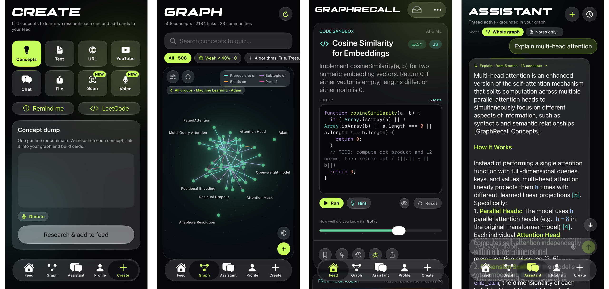
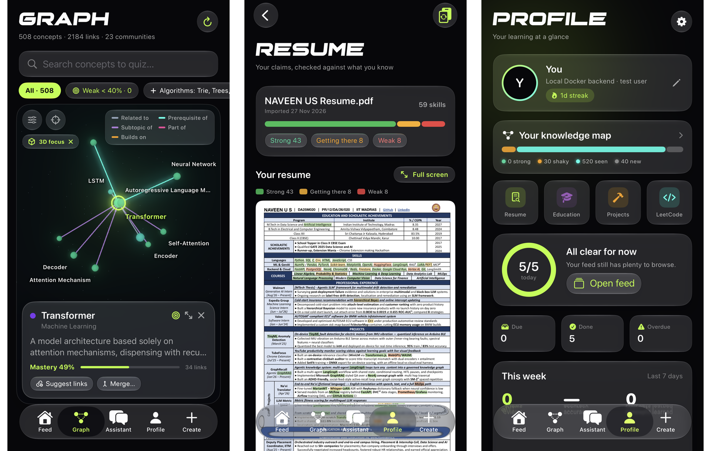

# GraphRecall — what makes it special to me

*Naveen U S · github.com/usnaveen/GraphRecall · graphrecall.online*

## The problem

GraphRecall solves several problems at once.

- **Too much to learn, no idea where to start.** Smart people with ADHD-like attention know this well. There's so much to catch up on and so much new to learn that I often end up doing neither. I wanted something that tells me what's worth focusing on right now, based on my own context.
- **Active recall doesn't scale by hand.** The best way to keep what you learn is to recall it again just before you'd forget it. Doing that across dozens of subjects means tracking what to revise and when, and nobody can do that in their head.
- **AI agents don't know what you know.** When I ask an AI assistant to explain a research paper, it can't tell which concepts I'm already comfortable with and which ones I've never seen. So it either re-explains the basics or skips the one prerequisite I'm missing.
- **Learning is scattered, and some of it simply vanishes.** I learn from papers, textbooks, YouTube, newsletters, LeetCode and long conversations with AI assistants. Those conversations are mostly lost. I wanted one place to drop everything important, without organising it first, and still find and query the right source later.
- **No honest picture of strengths and weaknesses.** Once everything is in one place, periodic quizzes can show how well you actually understand each topic.
- **Notes and knowledge graphs that never get opened again.** People build beautiful graphs in note-taking apps and never look at them again. They look impressive, but they are pictures, not memory.

## What GraphRecall does

GraphRecall turns everything you learn into an **active knowledge graph**.

1. **Concepts are extracted from whatever you drop in.** Type, paste a link or YouTube video, import a chat, upload a PDF or a whole book, scan a page or just talk. Each concept joins a node you already have or becomes a new one. Directed links say "this is a prerequisite of that" and "this is part of that".
2. **The graph comes back to you as a feed you actually want to open.** It scrolls like social media, not like a to-do list, so it works even on days when focus is hard. Spaced repetition decides what comes back and when. If you slip on something, the scheduler goes back to the prerequisites underneath it.
3. **An assistant answers from your own notes**, with citations, and suggests the next question based on where you're weak.
4. **The same graph becomes context for any AI agent.** Through an MCP server, Claude or any other agent can ask what you know well, what's shaky and what you've never seen, and then explain at your level. It can also write back what you learned in that conversation.

## The approaches I'm proudest of

- **It ingests almost anything.** Text, links, YouTube videos, chat exports, PDFs and whole books, photos and scanned pages, voice, and LeetCode problems by number. You can also share to it from any app, and it does the organising for you.
- **An MCP server that carries your knowledge into any AI agent.** Before answering, an agent such as Claude can ask GraphRecall what you already know well, what you're shaky on and what you've never seen, and explain at your level. After a long session, it sends back every concept you discussed, so your graph grows from those conversations too, along with a summary of the session.
- **A multi-agent harness.** LangGraph workflows handle ingestion and chat. Background agents research the concepts you add, curate videos and articles that match your graph, and queue suggestions into your feed for you to approve.
- **Hybrid RAG over a knowledge graph.** Vector search, keyword search and the graph itself are fused with reciprocal rank fusion, then reranked and diversified. Answers cite your own notes, and the cache is tied to a version of your notes, so a deleted note is never served back.
- **Built to be cheap to run.** Small, fast models by default. A small trained classifier routes questions without an LLM call, and the "ask next" suggestions come straight from the graph at zero tokens. Books are chunked by rules, not by a model. Embeddings and answers are cached, and the expensive whole-graph summarising runs only when a question needs it.
- **Resume/JD check.** Every skill on your resume is highlighted from red to green, based on what your knowledge graph says about you. It gives you an at-a-glance picture of how ready you are, at any point in time. The same approach applies to a job description.
- **Hand-crafted feed cards for each kind of content.** Each type of content gets its own card: concept cards with figures from your own papers, term cards, multiple-choice quizzes, "spot the bug" cards, runnable code sandboxes, diagrams with hidden labels to fill in, and videos and articles from sources you follow.
- **Everything that needs your attention today, in one feed.** Spaced-repetition reviews, newsletters and important updates are brought together in a single daily feed, so you know exactly what to focus on.
- **Agents that keep your feed in step with your life.** Agents can read your education, course grades, projects and knowledge, and queue exam or interview prep into your feed, so it stays relevant to what's coming up.
- **A real iOS app with a real backend.** A native SwiftUI app with a hand-crafted UI, on a FastAPI backend with PostgreSQL, pgvector and Neo4j.
- **AgentMesh: the team of AI agents that built it.** GraphRecall was built by me working with multiple AI coding agents at once. To keep them from overwriting each other, I built AgentMesh, a small local MCP server that coordinates them. Each agent has an inbox. Tasks can be claimed by only one agent and can only be closed with proof: the commit, the commands run and the test result. Expiring locks stop two agents editing the same files, database or API quota, and a searchable log keeps the decisions they've made. For GraphRecall alone, the agents exchanged 133 messages and handed off 18 tasks through it, and I stayed the one reviewing and deciding.

## Why it's personal

GraphRecall started as a tool to fix my own problems during my Master's at IITM. Over the past year it became the place where every idea I had about learning ended up. Whenever something annoyed me while studying, it became a feature. The repository has more than 400 commits since January, and almost every one traces back to a moment when I thought "this should exist".

It also taught me how to build. I learned to design an end-to-end AI system: retrieval, caching, evaluation harnesses, graph databases, a native iOS app and a protocol server for agents. I learned to work with AI coding agents as teammates: splitting work between them, reviewing their output and keeping them honest. And I learned to ship: build pipelines, devices, domains, deployment, and the discipline of only claiming what actually works.

GraphRecall is the project where I stopped forgetting what I learned, and it's the project I learned the most from building.
