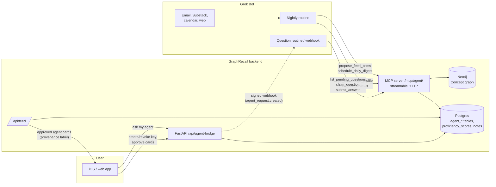

# Agent bridge: an always-on agent for GraphRecall (proposal)

**Status:** proposal + scaffolding on `feat/agent-bridge-mcp`. Everything is behind
`AGENT_BRIDGE_ENABLED=1`; with the flag off, the only behaviour change is that the
migration creates four empty tables on boot.

## Why

GraphRecall's built-in assistant is fast and local to the app, but limited. An external,
always-on agent (Grok Bot) can do work the app can't: read the user's email and Substack,
know about upcoming exams, run long research, and work overnight. The bridge lets the two
cooperate without giving the agent the keys to everything.

## Two directions

| | Agent → GraphRecall | GraphRecall → Agent |
|---|---|---|
| What | Agent reads knowledge/mastery, proposes curated feed cards and a daily digest | In-app assistant hands a question to the agent and gets an answer back later |
| Transport | MCP over streamable HTTP at `/mcp/agent/` | `agent_requests` queue (REST for the app, MCP tools for the agent) + optional signed webhook |
| Latency | Agent's schedule (e.g. nightly) | **Asynchronous — minutes, not seconds** |
| Auth | Scoped per-user agent key (`grk_…`) | App user's Google token (enqueue/poll); agent key (claim/answer) |

### Why the reverse direction is a queue, not a live call

Grok Bot can't be called synchronously from GraphRecall: it has no request/response
endpoint to call mid-chat. It acts when a routine fires, or when an inbound message or
webhook wakes it. So the app **enqueues** the question. The agent **polls**
(`list_pending_questions` on a routine) or is **woken** by the webhook, then
`claim_question`, does the work, and calls `submit_answer`. The app shows a pending bubble
and resolves it from `GET /api/agent-bridge/requests/{id}` or its SSE `/stream`.
Expect minutes. Quick answers should stay with the local assistant.

## MCP tools

| Tool | Scope | Notes |
|---|---|---|
| `get_knowledge_profile` | `read:knowledge` | Domains + avg mastery, weakest/strongest concepts, due count |
| `search_concepts` | `read:knowledge` | Substring match for now (TODO: hybrid retrieval) |
| `get_concept_neighborhood` | `read:knowledge` | 1 hop, ≤ 25 neighbours, both endpoints owned |
| `list_due_reviews` | `read:knowledge` | SM-2 due items via `SpacedRepetitionService` |
| `get_recent_activity` | `read:knowledge` | Recent reviews + note *titles/links* (never bodies) |
| `propose_feed_items` | `write:feed` | ≤ 20/call, lands as `pending`, idempotent |
| `schedule_daily_digest` | `write:feed` | One digest per user per day (upsert) |
| `list_pending_questions` | `bridge:answer` | Queued + claimed (with `claimable` flag) |
| `claim_question` | `bridge:answer` | Atomic, leased (60 s–60 min) |
| `submit_answer` | `bridge:answer` | Needs the current `claim_token` and a live lease |

## App-side REST (`/api/agent-bridge`, Google auth)

- `POST /keys` (plaintext key returned **once**), `GET /keys`, `DELETE /keys/{id}`
- `GET /feed-items?status=pending`, `POST /feed-items/{id}/approve|reject`
- `POST /requests` (202), `GET /requests`, `GET /requests/{id}`, `GET /requests/{id}/stream` (SSE), `POST /requests/{id}/cancel`

Approved cards appear in `GET /api/feed` as `item_type: "agent_curated"` with
`content.provenance.label = "Curated by your agent"`, the source URL and the agent's reason.

## Security and privacy

- **Scoped, per-user keys.** Each key is bound to one `user_id` and to scopes
  `read:knowledge`, `write:feed` and `bridge:answer`. Only `sha256(pepper + key)` is stored
  (`AGENT_KEY_PEPPER`); the plaintext is shown once. Keys expire (default 90 days), with at
  most five active keys per user.
- **Ownership is enforced on every path.** Tools never take a `user_id` argument (extra
  arguments are rejected), and every SQL and Cypher query filters by the key owner.
  Another user's concept, feed item or question returns the same `not_found`/`conflict`
  as a missing one. Concept ids the agent tags on a card are checked against the owner's
  graph, and any that aren't theirs are dropped.
- **Revocation.** `DELETE /keys/{id}` takes effect on the next request, because keys are
  checked on every HTTP call. The MCP transport is stateless, so no long-lived session
  outlives a revoked key.
- **Rate limits and quotas** (`limits.py`, pluggable; Postgres/Redis shared backend, in-memory
  fallback). MCP calls are limited per key (120/min, `429` + `Retry-After`). Enqueues are
  limited per user (20/h). Proposals are limited per key (100/day). New pending cards are
  capped per user (50/day), checked inside the insert transaction.
- **Host/Origin allowlist** against DNS rebinding: a foreign `Host` gets 421 and a foreign
  `Origin` gets 403. The SDK's `TransportSecuritySettings` is set too.
- **Audit log.** `agent_audit_log` records tool calls, key create and revoke,
  approve/reject, enqueues and answer submissions. It stores metadata only (ids and
  counts, never text) and is visible to the user at `GET /api/agent-bridge/audit`.
- **No raw email stored.** `propose_feed_items` accepts a curated `summary` (≤ 2000
  chars), a `reason` and a source **link**. The agent is instructed never to paste email
  bodies. GraphRecall stores no mailbox content and makes no calls to Gmail or Substack.
- **User approval.** Agent cards land as `pending` and only reach the feed after
  approval (TODO: an opt-in auto-approve setting per key). Every card is labelled with
  its provenance.
- **Minimal outbound data.** Knowledge tools return names, domains, mastery and short
  (≤ 280 chars) definitions. Note bodies and chat transcripts are never exposed. The
  webhook payload carries only ids; the question text is fetched over MCP with the key.
- **Signed webhooks.** Each event carries a unique `X-GraphRecall-Event-Id` and an
  `X-GraphRecall-Timestamp`. `X-GraphRecall-Signature: t=…,id=…,v1=HMAC_SHA256(secret,
  "t.id.body")` binds both, with a 5-minute window. Delivery is retried, so receivers
  **must dedupe on the event id**; `verify_webhook()` + `ReplayGuard` does this.
- **Agent text is untrusted (prompt injection).** Answers, card titles and summaries are
  written by an outside agent that reads email and the web, so they may carry injected
  instructions or markup.
  - Clients render them as **plain text**: no HTML, and no auto-linking beyond the
    validated `source_url` and citation URLs, which must be http(s).
  - Before such text reaches GraphRecall's own chat model, it is wrapped with
    `untrusted.wrap_untrusted()`, which delimits it as data and neutralises forged markers.
  - The model must never follow instructions found inside it.

## Example flows

**Nightly curation (01:00 IST).** The Grok Bot routine calls `get_knowledge_profile` and
`list_due_reviews`, then scans new Substack posts and email newsletters (in Grok Bot, not
GraphRecall) and checks the calendar for exams. It picks 3–8 items and calls
`propose_feed_items` with `idempotency_key = "nightly-<date>-<n>"` and
`target_date = tomorrow`, then `schedule_daily_digest`. In the morning the user approves
the cards in the app, and they show in the feed.

**Ask my agent.** In chat, the user taps "Ask my agent" for "Which DBMS topics should I
revise for Friday's exam?". The app calls `POST /requests` and shows a pending bubble.
The webhook (or the bot's every-15-minute routine) wakes Grok Bot, which runs
`claim_question`, `get_knowledge_profile`/`search_concepts`, its own research, and then
`submit_answer`. The app's SSE stream resolves the bubble.

**Agent uses GraphRecall as context.** When the user asks Grok Bot to plan their week,
it calls `get_knowledge_profile` / `search_concepts` to see what they already know before
answering.

See `GROK_BOT_SETUP.md` for connector registration and routine prompts, and
`IMPLEMENTATION_STATUS.md` for what is done versus still to do.
